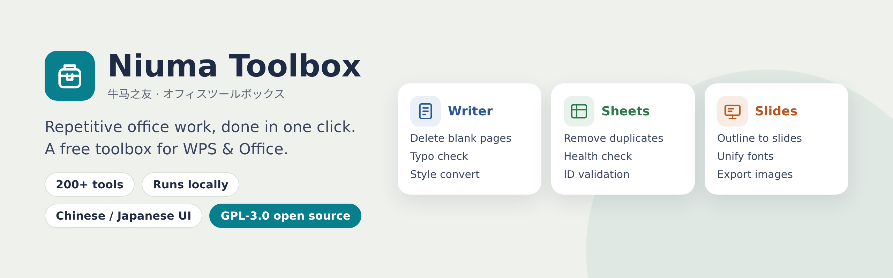
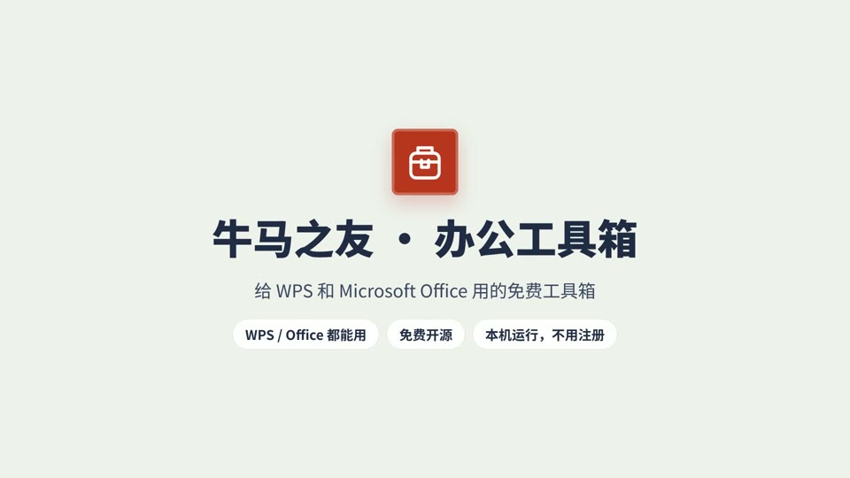

**牛马之友 · 办公工具箱 / オフィスツールボックス / Niuma Toolbox**

Free open-source toolbox for WPS / Microsoft Office: 公文格式、删除空白页、表格体检、数据脱敏、です・ます変換、郵便番号、和暦 (document formatting, blank-page removal, spreadsheet checks, data masking and Japanese office tools).

<p align="center">
  
</p>

<h1 align="center">Niuma Toolbox · Office Toolbox</h1>

<p align="center">
  A free productivity toolbox for WPS Office and Microsoft Office: one-click formatting, spreadsheet cleanup and slide making.<br>
  No sign-up, works offline. AI is optional.
</p>

<p align="center">
  <a href="README.md">简体中文</a> ｜ <a href="README.ja.md">日本語</a> ｜ <b>English</b>
</p>

<p align="center">
  
  
   
</p>

## Videos and manuals



[Chinese promo video (download MP4)](https://github.com/zhufu0801-sudo/niuma-toolbox/releases/download/v0.16.0/niuma-toolbox-promo-zh-v2.mp4) · [Japanese promo video (download MP4)](https://github.com/zhufu0801-sudo/niuma-toolbox/releases/download/v0.16.0/niuma-toolbox-promo-ja-v2.mp4)

[English PDF](docs/manual-en.pdf) · [中文 PDF](docs/manual-zh.pdf) · [日本語 PDF](docs/manual-ja.pdf) · [Promo copy](docs/promo/宣传视频文案-20261126.md)

2026-11-26: Claude changed the completion-dialog border, WPS Writer ribbon deduplication and layout menu, and page recount after blank-page deletion. These changes have **not been validated in a real WPS host**. Mac / Microsoft Office hosts, trusted VBA-project access and Word DOCX TOC updates are **untested**.


---

## What is it?

Office work is full of small, repetitive steps: deleting blank pages, unifying fonts, removing duplicate rows, numbering slides…
**Niuma Toolbox** ("牛马之友", a friend for hard-working office workers) turns these steps into buttons. They appear on a new tab in WPS and Microsoft Office, and each one does its job with a single click.

- **One click**: 200+ tools grouped by Writer / Spreadsheet / Presentation.
- **Review before applying**: undo depends on the host and feature. WPS spreadsheet tool writes generally cannot be undone with Ctrl+Z. Back up important files and check output locations.
- **Your files stay on your PC**: formatting, cleanup, templates and file conversion all run locally.
- **Chinese and Japanese**: the interface comes in Chinese and Japanese, with Chinese official-document format (GB/T 9704), Japanese business documents, Japanese era dates, seal boxes, vertical text and postcard addressing.
- **Optional AI**: bring your own API key for AI writing and translation. Everything else works without it.

> Public beta (0.16.0). Windows + WPS is the most tested setup. The Microsoft Office and macOS versions are still being tested, so back up important files first.

## Features

| | Highlights |
|---|---|
| **Writer** | Delete blank pages, body text formatting, Chinese official-document format, Japanese business letters, table of contents, table styling, remove watermarks, Word → PowerPoint |
| **Proofing** | Pre-send check (comments, tracked changes, author info), typo & punctuation check, Japanese style conversion (desu/masu ⇄ de-aru, no AI), compare documents, figure/table captions, fix heading numbering |
| **Spreadsheet** | Row/column spotlight, sheet health check, formula helper, remove duplicates, text → numbers, compare two tables, payslips, mask personal data |
| **Data tools** | ID number validation (China USCC, Japanese corporate number, etc.), merge workbooks, show amounts in 10k / thousands, batch QR codes & barcodes, attendance summary |
| **Presentation** | Outline → slides, 12 bilingual templates with animations, unify fonts and titles, slide numbers, export slides as images or one long image, handouts, slim down file size |
| **Files & PDF** | OCR, PDF → Word, merge/split PDFs, batch PDF export, batch watermark, batch rename, version history and auto-backup, data masking (reversible) |
| **Dates & forms** | Insert today's date, business-day calculator (China & Japan holidays), seal boxes, stock phrases, form templates, mail merge from Excel |
| **Print & fax** | Pre-print check, fax cover sheets, envelopes, Japanese postcards, address labels |
| **Cross-document** | Paste bar, content cards, linked modules that update across files |
| **AI (optional)** | Chat, summarize, continue, rewrite, Chinese ⇄ Japanese translation and business keigo, formula writing |

## Masking and additional tools

- **Automatic MCP masking**: enabled by default when an agent reads through the toolbox. Recognized personal data and word-list names become codes; writes restore their original values. Maps stay in session memory. This cannot intercept an agent reading files through other routes.
- **Masked copy / restored paste**: copy coded text to a web AI, then restore codes in its reply before inserting it. Inspect the text before sending; unknown codes remain with a warning.
- **Macro checking**: statically checks VBA read from the host or pasted manually. It does not execute macros; direct access depends on host permissions.
- **Japanese addresses ↔ postal codes**: look up Japan Post data or convert spreadsheet ranges, update data manually, and mark unmatched results.

## Detailed manuals and support

For steps, options, limits and recovery, read the [English manual](docs/manual/en.md), [中文](docs/manual/zh.md), or [日本語](docs/manual/ja.md).
Printable PDF and editable DOCX editions are provided with the [0.16.0 beta release](https://github.com/zhufu0801-sudo/niuma-toolbox/releases/tag/v0.16.0). Windows and Mac packages include the corresponding Chinese or Japanese PDF.
Report problems and suggestions through [GitHub Issues](https://github.com/zhufu0801-sudo/niuma-toolbox/issues). Include the host version, steps and exact message using the issue template, and remove sensitive information from documents and logs first.

## Install

1. Download the latest release from [Releases](https://github.com/zhufu0801-sudo/niuma-toolbox/releases):
   - Windows: `OfficeToolbox-<version>-Windows-x64.zip`
   - macOS (beta): `OfficeToolbox-<version>-macOS.zip`
2. **Windows**: unzip and double-click `Start.cmd`, then choose WPS, Microsoft Office, or both.
   **macOS**: in Finder, right-click `install.command` and choose **Open**.
3. Quit WPS / Office completely and open it again. A new "Office Toolbox" tab appears at the top.

**Requirements**
- WPS Office, or the Word, Excel and PowerPoint apps from Microsoft 365 / Office 2021 or later.
- Windows 10 / 11 (64-bit) or macOS 11+.

**Notes**
- The Office add-in needs a certificate that is trusted only for localhost. The installer explains this step.
- To uninstall, run `Uninstall.cmd` (or `uninstall.command` on Mac). Documents and backups remain. Windows removes saved AI settings and API keys while retaining ordinary settings and cards; see the manual for Mac retention details.

## Privacy

- Everything except AI runs on your computer. Your documents are not collected or uploaded.
- When you use AI, content goes only to the provider you configure. Phone numbers, ID numbers and other personal data are masked before sending. You can also add your own rules with a [privacy plugin](plugins/README.md).
- No auto-update, no automatic e-mail or fax sending, and no automatic printing.

Postal-data updates, version checks and initial component downloads may use the network. Masking does not guarantee detection of every sensitive item; inspect results before sending.

## Development

```bash
git clone https://github.com/zhufu0801-sudo/niuma-toolbox.git
cd niuma-toolbox
npm ci
npm test        # run all automated tests
npm start       # start the local service
```

Requires Node.js 22+.

Project layout:
- `server.mjs` and `lib/`: the local service (files, OCR, PDF, AI relay, Japanese tokenizer).
- `public/`: the WPS add-in. Module notes are in [`public/tools/README.md`](public/tools/README.md), in Chinese.
- `public/office/`: the Microsoft Office add-in.
- `test/`: the automated tests.

Issues and suggestions are welcome. When reporting a bug, include your WPS / Office version, the steps you took, and the message you saw.

## License

Niuma Toolbox is licensed under [GNU GPL v3.0](LICENSE). You may use, modify and redistribute it. If you distribute a modified version, you must release its source code under GPL-3.0.

Third-party licenses, such as pdf-lib (MIT) and kuromoji (Apache-2.0), are listed in `THIRD-PARTY-NOTICES.txt`.

"WPS" is a trademark of Kingsoft Office, and "Microsoft Office" is a trademark of Microsoft. This project is not affiliated with either company.

Project-owned code uses GPL-3.0; third-party files retain their own licenses. The unmodified [WPS SDK license](WPS-SDK-LICENSE.txt) includes restrictions on modification and standalone sale and is not replaced by this project’s GPL grant.

## Disclaimer

This software is provided "as is", without warranty of any kind.

- Business templates, amount-in-words conversion and ID validation are aids only. Check the results yourself before using them officially.
- Electronic seals are images only and are not legal electronic signatures.
