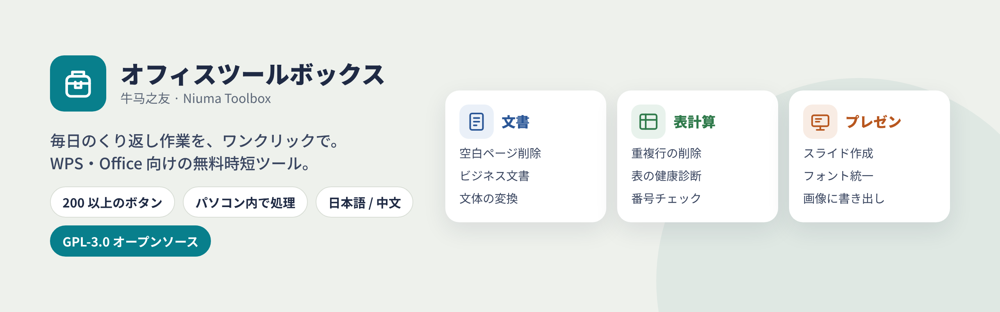
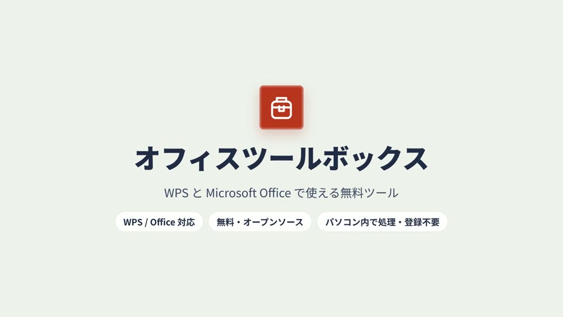
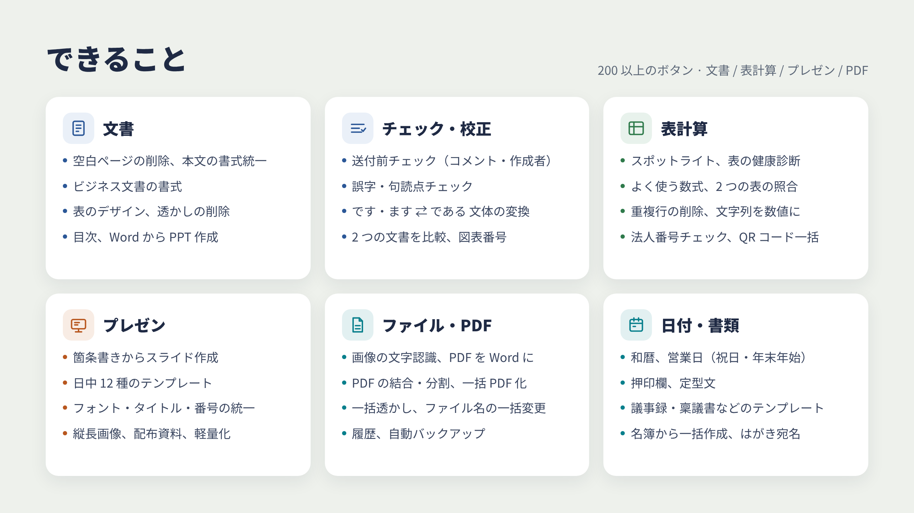

**牛马之友 · 办公工具箱 / オフィスツールボックス / Niuma Toolbox**

WPS / Microsoft Office 向け無料オープンソース：公文格式、删除空白页、表格体检、数据脱敏、です・ます変換、郵便番号、和暦。

<p align="center">
  
</p>

<h1 align="center">オフィスツールボックス</h1>

<p align="center">
  WPS と Microsoft Office で使える無料の時短ツール。書式の整え、表の整理、スライド作りをワンクリックで。<br>
  登録不要、オフラインでも使えます。AI は使いたい人だけ。
</p>

<p align="center">
  <a href="README.md">简体中文</a> ｜ <b>日本語</b> ｜ <a href="README.en.md">English</a>
</p>

<p align="center">
  
  
   
</p>

## 紹介動画・操作ガイド



[日本語の紹介動画（MP4 ダウンロード）](https://github.com/zhufu0801-sudo/niuma-toolbox/releases/download/v0.16.0/niuma-toolbox-promo-ja-v2.mp4) · [中国語の紹介動画（MP4）](https://github.com/zhufu0801-sudo/niuma-toolbox/releases/download/v0.16.0/niuma-toolbox-promo-zh-v2.mp4)

[日本語 PDF](docs/manual-ja.pdf) · [中文 PDF](docs/manual-zh.pdf) · [English PDF](docs/manual-en.pdf) · [紹介文](docs/promo/宣传视频文案-20261126.md)

2026-11-26：Claude による完了ダイアログの枠線、WPS Writer リボンの重複削除とメニュー化、空白ページ削除後のページ数再計算は**変更済みですが、WPS 実機では未検証**です。Mac / Microsoft Office ホスト、VBA プロジェクトへの信頼アクセス、Word DOCX の目次更新は**未検証**です。


---

## どんなツール？

毎日の文書・表計算・プレゼンの作業には、決まった手順のくり返しがたくさんあります。空白ページの削除、書式の統一、重複行の削除、ページ番号の追加……。
**オフィスツールボックス**は、そうした「よく使うのに手間がかかる」操作をボタンにまとめました。WPS と Office の上部にタブが追加され、クリックするだけで完了します。

- **ワンクリック**：200 以上のボタンを「文書 / 表計算 / プレゼン」に分けて配置。メニューを探す必要はありません。
- **確認してから処理**：元に戻せるかはホストと機能によります。WPS 表計算へのツール書き込みは通常 Ctrl+Z で戻せません。重要なファイルは先にバックアップし、出力先を確認してください。
- **データはパソコンの中だけ**：書式の整え、表の整理、テンプレート、ファイル処理はすべて手元のパソコンで動きます。
- **日本語と中国語**：画面は日本語と中国語を切り替えられます。ビジネス文書、和暦、押印欄、縦書き、はがき宛名などにも対応しています。
- **AI は任意**：AI で文章作成や翻訳をしたいときは、ご自分の API を設定してください。設定しなくてもほかの機能はすべて使えます。

> 現在は公開ベータ版（0.16.0）です。いちばん多くテストしているのは Windows + WPS の組み合わせです。Microsoft Office 版と Mac 版はテスト中のため、大事なファイルは先にバックアップを取ってからお使いください。

## 主な機能

<p align="center"></p>

| | 主な機能（例） |
|---|---|
| **文書** | 空白ページの削除、本文の書式統一、ビジネス文書の書式、目次、表のデザイン、透かしの削除、Word から PPT を作成 |
| **チェック・校正** | 送付前チェック（コメント・変更履歴・作成者情報）、誤字・句読点チェック、文体の変換（です・ます ⇄ である、AI 不使用）、2 つの文書を比較、図表番号、見出し番号の修復 |
| **表計算** | スポットライト、表の健康診断（検索できない・合計が合わない原因）、よく使う数式、重複行の削除、文字列を数値に、2 つの表の照合、給与明細、個人情報のマスク |
| **データツール** | 番号チェック（法人番号・インボイス登録番号など）、複数ブックの結合、千円・万単位の表示、QR コード / バーコードの一括作成、勤怠集計 |
| **プレゼン** | 箇条書きからスライドを作成、日中 12 種のテンプレート（アニメーション付き）、フォントとタイトルの統一、ページ番号、画像・縦長画像に書き出し、配布資料の印刷、PPT の軽量化 |
| **ファイル・PDF** | 画像の文字認識、PDF を Word に変換、PDF の結合・分割、一括 PDF 化、一括透かし、ファイル名の一括変更、履歴と自動バックアップ、データのマスキング（元に戻せる） |
| **日付・書類** | 今日の日付（和暦も）、営業日の計算（日本の祝日・年末年始）、押印欄、定型文、議事録・稟議書などのテンプレート、名簿から一括作成 |
| **印刷・FAX** | 印刷前チェック、FAX 送付状、封筒、はがき宛名（縦書き）、宛名ラベル |
| **文書間の連携** | 貼り付けバー、コンテンツカード、連動モジュール（元の内容を変えると、ほかのファイルもワンクリックで更新） |
| **AI（任意）** | AI チャット、要約、続きを書く、書き換え、日中翻訳とビジネス敬語、数式の作成 |

## マスキングと追加ツール

- **MCP の自動マスキング**：agent がツールボックス経由で読むと、検出した個人情報や単語リストの名称を記号に置き換え、書き戻すと原文に戻します。初期状態はオンで、対応表はセッションのメモリ内だけに保持します。agent による別のファイル読み取りは制御できません。
- **マスキングしてコピー / 復元して貼り付け**：記号化した文章を Web AI に渡し、回答の記号を復元して文書へ挿入します。送信前に内容を確認してください。不明な記号は残して通知します。
- **マクロのチェック**：読み込んだ、または貼り付けた VBA を静的にチェックします。マクロは実行しません。直接の読み取りにはホストの権限が必要です。
- **住所 ↔ 郵便番号**：日本郵便のデータで検索し、表計算では一括変換できます。手動更新に対応し、一致しない結果は色で示します。

## 詳細ガイドと不具合報告

手順・設定・制限・復元方法は [日本語ガイド](docs/manual/ja.md)、[中文](docs/manual/zh.md)、[English](docs/manual/en.md) をご覧ください。
印刷用 PDF と編集可能な DOCX は [0.16.0 ベータ版 Release](https://github.com/zhufu0801-sudo/niuma-toolbox/releases/tag/v0.16.0) に用意します。Windows / Mac のパッケージには対応言語の PDF を同梱します。
不具合や要望は [GitHub Issues](https://github.com/zhufu0801-sudo/niuma-toolbox/issues) へ。テンプレートにホストの版・手順・表示メッセージを記入し、添付する文書やログから機密情報を取り除いてください。

## インストール

1. [Releases](https://github.com/zhufu0801-sudo/niuma-toolbox/releases) から最新版をダウンロードします。
   - Windows：`OfficeToolbox-バージョン-Windows-x64-ja.zip`
   - macOS（ベータ）：`OfficeToolbox-バージョン-macOS-ja.zip`
2. **Windows**：展開して `Start.cmd` をダブルクリックし、WPS・Microsoft Office・両方のどれに入れるかを選びます。
   **macOS**：Finder で `install.command` を右クリック →「開く」。
3. WPS / Office をいったん完全に終了して開き直すと、上部に「オフィスツールボックス」タブが表示されます。

**動作環境**
- WPS Office、または Microsoft 365 / Office 2021 以降の Word・Excel・PowerPoint。
- Windows 10 / 11（64 ビット）、または macOS 11 以降。

**補足**
- Office 版を入れるときは、このパソコン（localhost）専用の証明書を信頼する必要があります。インストール時に案内が出ます。
- アンインストール：`Uninstall.cmd`（Mac では `uninstall.command`）を実行します。文書とバックアップは残ります。Windows では保存した AI 設定と API Key を削除し、通常の設定とカードは残します。Mac の詳細はガイドをご覧ください。

## プライバシー

- AI 以外の機能はすべてパソコン内で処理します。文書を集めたり送ったりすることはありません。
- AI を使う場合、内容はご自分で選んだ AI サービスに送られます。送る前に電話番号などの個人情報を自動で伏せます。会社独自のルールも [プライバシー用プラグイン](plugins/README.md) で追加できます。
- 自動更新、メールや FAX の自動送信、自動印刷はしません。

郵便番号データの更新、バージョン確認、初回のコンポーネント取得では通信する場合があります。マスキングは機密情報すべての検出を保証しません。送信前に確認してください。

## 開発

```bash
git clone https://github.com/zhufu0801-sudo/niuma-toolbox.git
cd niuma-toolbox
npm ci
npm test        # 自動テストをすべて実行
npm start       # ローカルサービスを起動
```

Node.js 22 以降が必要です。フォルダー構成と開発ルールは [中国語版 README](README.md#开发) を参照してください。不具合の報告や要望は Issue でお気軽にどうぞ。報告の際は、WPS / Office のバージョン、操作の手順、表示されたメッセージを書いてください。

## ライセンス

[GNU GPL v3.0](LICENSE) です。

- 自由に使用・改変・再配布できます。
- 改変版を配布する場合は、GPL-3.0 でソースコードを公開してください。
- 第三方コンポーネントのライセンスは `THIRD-PARTY-NOTICES.txt` にあります。例：pdf-lib（MIT）、kuromoji（Apache-2.0）など。

「WPS」は Kingsoft Office の、「Microsoft Office」は Microsoft の商標です。本プロジェクトは両社とは関係ありません。

本プロジェクト独自のコードは GPL-3.0、第三者のファイルは各自のライセンスに従います。[WPS SDK ライセンス](WPS-SDK-LICENSE.txt) は原文を保持し、改変や単独販売の禁止など独自の条件があります。プロジェクトの GPL を適用するものではありません。

## 免責事項

本ソフトウェアは現状のまま提供され、いかなる保証もありません。

- ビジネス書類のテンプレートや番号チェックは補助機能です。正式に使う前に、内容をご自身で確認してください。
- 電子印鑑は画像であり、電子署名としての効力はありません。
