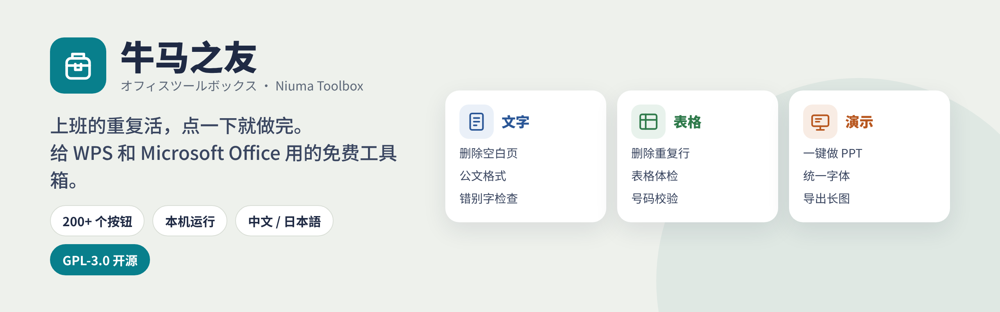
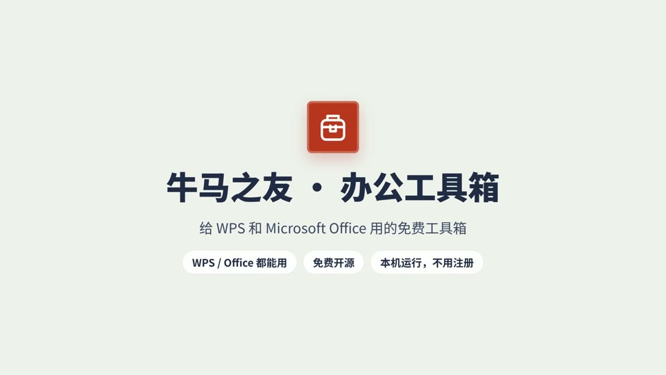
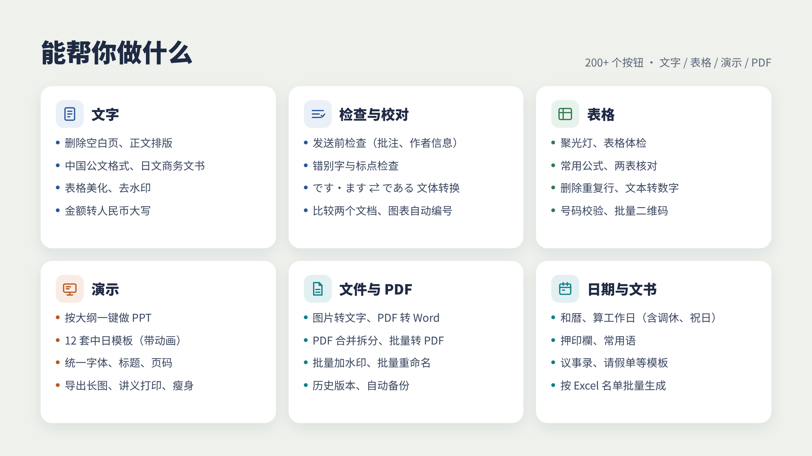

**牛马之友 · 办公工具箱 / オフィスツールボックス / Niuma Toolbox**

WPS / Microsoft Office 免费开源工具箱：公文格式、删除空白页、表格体检、数据脱敏、です・ます変換、郵便番号、和暦。

<p align="center">
  
</p>

<h1 align="center">牛马之友 · 办公工具箱</h1>

<p align="center">
  给 WPS 和 Microsoft Office 用的免费工具箱：排版、表格整理、做 PPT 都能一键完成。<br>
  不注册，不联网也能用；AI 是可选功能。
</p>

<p align="center">
  <b>简体中文</b> ｜ <a href="README.ja.md">日本語</a> ｜ <a href="README.en.md">English</a>
</p>

<p align="center">
  
  
   
  
</p>

## 宣传视频与说明书



[中文宣传视频（下载 MP4）](https://github.com/zhufu0801-sudo/niuma-toolbox/releases/download/v0.16.0/niuma-toolbox-promo-zh-v2.mp4) · [日本語の紹介動画（MP4）](https://github.com/zhufu0801-sudo/niuma-toolbox/releases/download/v0.16.0/niuma-toolbox-promo-ja-v2.mp4)

[中文说明书 PDF](docs/manual-zh.pdf) · [日本語 PDF](docs/manual-ja.pdf) · [English PDF](docs/manual-en.pdf) · [宣传文案](docs/promo/宣传视频文案-20261126.md)

2026-11-26：Claude 修改的完成提示窗边框、WPS 文字功能区去重和收起、删除空白页后重算页数，**已修改，尚未在 WPS 真机验证**。Mac / Microsoft Office 宿主、VBA 信任路径、Word DOCX 目录：**未测**。


---

## 这是什么

上班天天和文档、表格、PPT 打交道，很多操作其实就是那几步：删空白页、统一格式、去掉重复行、给每页加页码……
**牛马之友**把这些常用但费时间的操作做成按钮，装好后出现在 WPS 和 Office 顶部，点一下就做完。

- **一键完成**：200 多个按钮，按“文字 / 表格 / 演示”分好类，不用记菜单在哪里。
- **先确认再处理**：撤销能力因宿主和功能而异，WPS 表格的工具写入通常不能用 Ctrl+Z 恢复。重要文件先备份，并核对输出位置。
- **数据留在本机**：排版、整理、模板、文件处理都在你自己的电脑上运行，不上传。
- **中文和日文**：界面可以切换中文或日文。中国公文、日本商务文书、和暦、押印欄、竖排都考虑到了。
- **AI 可选**：想用 AI 写作、翻译时，接入你自己的 API；不接也不影响其他功能。

> 现在是公开测试版（0.16.0）。Windows + WPS 测得最多；Microsoft Office 版和 Mac 版还在测试中，用于重要文件前请先备份。

## 功能一览

<p align="center"></p>

| | 常用功能（举例） |
|---|---|
| **文字** | 删除空白页、正文排版、中国公文格式（GB/T 9704）、日文商务文书、目录、表格美化、去水印、金额转人民币大写、Word 转 PPT |
| **检查与校对** | 发送前检查（批注、修订、作者信息）、错别字与标点、日文文体转换（です・ます ⇄ である）、比较两个文档、图表自动编号、修复多级编号 |
| **表格** | 聚光灯、表格体检（查不到、求和不对的原因）、常用公式、删除重复行、文本转数字、两表核对、工资条、敏感信息打码 |
| **数据工具** | 号码校验（统一社会信用代码、身份证、法人番号）、合并多个工作簿、万元显示、批量二维码 / 条形码、考勤统计 |
| **演示** | 按大纲生成 PPT、12 套中日模板（带动画）、统一字体和标题、加页码、导出图片 / 长图、讲义打印、PPT 瘦身 |
| **文件与 PDF** | 图片转文字、PDF 转 Word、PDF 合并拆分、批量转 PDF、批量加水印、批量重命名、历史版本与自动备份、数据脱敏（可还原） |
| **日期与文书** | 插入今天日期（含和暦）、算工作日（含中国调休、日本祝日）、押印欄、常用语、日常文书模板、按名单批量生成 |
| **打印与传真** | 打印前检查、传真封面、信封、明信片宛名、地址标签 |
| **跨文档** | 粘贴栏、内容卡片、联动模块（原内容改了，别的文件一键更新） |
| **AI（可选）** | AI 对话、总结、续写、改写、中日翻译与商务敬语、帮写表格公式 |

完整清单见 [功能说明](docs/功能说明.md)。

## 数据脱敏与新增工具

- **MCP 自动脱敏**：agent 通过工具箱读取文档时，默认把已识别的个人信息和词表名称换成代号，写回时恢复原文。对应表只留在会话内存中；不能拦截 agent 直接读取其他文件。
- **脱敏复制 / 还原粘贴**：先复制代号文本给网页 AI，再把回答中的代号还原后插入文档。发送前请检查结果，未知代号会保留并提示。
- **宏代码检查**：检查读取或手动粘贴的 VBA 代码，不执行宏；直接读取受宿主权限限制。
- **住所 ↔ 郵便番号**：使用日本邮政数据做日本邮编、住所查询和表格批量转换，支持手动更新；无法匹配的结果会标记。

## 详细说明书与问题反馈

操作步骤、选项、限制和恢复方法见 [中文说明书](docs/manual/zh.md)、[日本語](docs/manual/ja.md)、[English](docs/manual/en.md)。
打印版 PDF 和可编辑 DOCX 随 [0.16.0 测试版 Release](https://github.com/zhufu0801-sudo/niuma-toolbox/releases/tag/v0.16.0) 提供；Windows 和 Mac 安装包内包含对应语言的 PDF。
问题和建议统一提交到 [GitHub Issues](https://github.com/zhufu0801-sudo/niuma-toolbox/issues)，请使用报错模板说明宿主版本、操作步骤和提示原文，并先删除文档、日志中的敏感信息。

## 安装

1. 到 [Releases](https://github.com/zhufu0801-sudo/niuma-toolbox/releases) 下载最新版：
   - Windows：`OfficeToolbox-版本号-Windows-x64.zip`（日文界面选 `-ja`）
   - macOS：`OfficeToolbox-版本号-macOS.zip`（测试版）
2. **Windows**：解压后双击 `Start.cmd`，选择装到 WPS、Microsoft Office，或者两个都装。
   **macOS**：在“访达”里右键点 `install.command` → “打开”。
3. 完全退出 WPS / Office 再重新打开，顶部会出现“办公工具箱”标签。

**系统要求**
- WPS Office（个人版或企业版）。
- 或者 Microsoft 365 / Office 2021 以上的 Word、Excel、PowerPoint。
- Windows 10 / 11（64 位）或 macOS 11 以上。

**说明**
- 安装 Office 版时，要信任一个只给本机（localhost）用的证书，安装程序会提示。
- 卸载：运行 `Uninstall.cmd`（Mac 上是 `uninstall.command`）。文档和备份保留；Windows 卸载会删除保存的 AI 设置与 API Key，普通设置和卡片保留。Mac 的保留规则见说明书。

## 隐私

- 除 AI 以外，所有功能都在本机完成，不收集、不上传你的文档。
- 用 AI 时，内容会发给你自己选的服务商。发送前会先自动隐藏手机号、身份证号等个人信息，也可以用 [隐私插件](plugins/README.md) 加上公司自己的规则。
- 不自动更新，不自动发送邮件或传真，不自动打印。

邮编数据更新、版本检查和初次下载组件可能联网；脱敏不是检出所有敏感信息的保证，发送前仍需检查。

## 开发

```bash
git clone https://github.com/zhufu0801-sudo/niuma-toolbox.git
cd niuma-toolbox
npm ci
npm test        # 运行全部自动测试
npm start       # 启动本机服务
```

- 需要 Node.js 22 或以上。
- 代码结构：
  - `server.mjs`、`lib/`：本机服务。负责文件处理、OCR、PDF、AI 转发，以及日文分词等。
  - `public/`：WPS 加载项界面和各个工具，模块说明在 [`public/tools/README.md`](public/tools/README.md)。
  - `public/office/`：Microsoft Office 加载项。
  - `test/`：自动测试。
- 新加功能时请一起加自动测试；界面文字用中文写，日文翻译放在 `public/i18n-ja-extra.js`。

欢迎提 Issue 报告问题、提建议。提问题时请写清楚：WPS 或 Office 的版本、操作步骤、看到了什么提示。

## 许可证

本项目使用 [GNU GPL v3.0](LICENSE)。你可以自由使用、修改和再发布。如果你把修改后的版本发给别人，也要按 GPL-3.0 公开源代码。

第三方组件的许可证见 `THIRD-PARTY-NOTICES.txt`，例如：
- pdf-lib（MIT）
- kuromoji（Apache-2.0）
- docx、exceljs、jszip、pptxgenjs 等

“WPS”是金山办公的商标，“Microsoft Office”是微软的商标。本项目和这两家公司没有关系。

本项目自有代码使用 GPL-3.0；第三方文件仍适用各自许可证。[WPS SDK 许可](WPS-SDK-LICENSE.txt) 原样保留，包含不得修改或单独销售的限制，不适用本项目代码的 GPL 授权。

## 免责声明

本软件按原样提供，不附带任何担保。商务模板、金额大写、号码校验等只是辅助，正式使用前请自己核对；电子印章只是图片，没有电子签名的法律效力。
